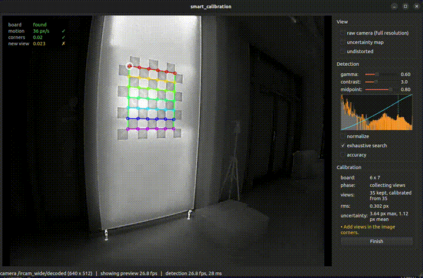
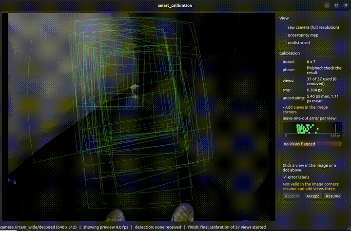
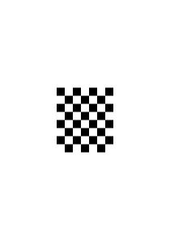
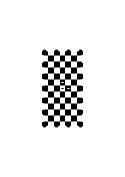

# smart_calibration

Interactive monocular camera calibration for ROS 2 Humble. A calibration node detects a
chessboard in the camera stream, keeps only good and new views, and calibrates in the background
while a GUI shows where the calibration is still uncertain. When enough views are collected, a
final pass removes outlier views, and the result is saved as an OpenCV YAML file.

<p align="center">
  
</p>

- **Board modes:** a plain chessboard, or a radon checkerboard with markers that only needs to
  be partly visible
- **View checks:** motion, misplaced corners and duplicates are rejected before a view is kept
- **Live guidance:** an uncertainty map over the image, plus hints on missing view types (tilts,
  image corners)
- **Final pass:** outlier views are removed automatically, and you can inspect each view's corner
  errors
- **Undistorted view:** check the calibration on the live stream
- **Tunable preprocessing** for low-contrast cameras (e.g. thermal): contrast stretch, gamma and
  an S-curve, with a live histogram

Camera models, chosen with `camera_model`:

- **`plumb_bob`** (default): pinhole with radial and tangential distortion (k1, k2, p1, p2, k3),
  `cv2.calibrateCamera`. For normal and moderately wide lenses, up to about 100° diagonal field
  of view.
- **`fisheye`**: Kannala-Brandt (k1-k4), the distorted radius a polynomial in the ray angle.
  For wide-angle and fisheye lenses, also beyond 180°. It is OpenCV's `cv2.fisheye` model (called
  `equidistant` in ROS camera_info), but calibrated by the package's own Levenberg-Marquardt
  ([fisheye_calibration.py](smart_calibration/smart_calibration/fisheye_calibration.py)):
  `cv2.fisheye.calibrate` mostly fails on lenses wider than 180° (opencv/opencv#23962, #30246).
  The calibrator assumes:
  - a planar grid board, with views as the detector delivers them (at least 5 × 5 corners), which
    the view checks ensure;
  - a roughly centred lens: the principal point starts at the image centre;
  - a diagonal field of view of 40° to 260°, the range its starting focal length scan covers;
  - a lens not far from equidistant (image radius f·θ), its starting point. Most fisheye lenses
    are close to that.

  Tested on synthetic lenses ([utility/fisheye_benchmark.py](utility/fisheye_benchmark.py), 5 to
  89 views): reliable for near-equidistant lenses from 140° to 260°, equisolid (180°),
  stereographic (190°) and an ordinary 60° lens. Lenses far from equidistant and wide, such as
  orthographic (160°) or an ordinary 100° lens, sometimes end in a wrong solution with an rms of
  several px; use `plumb_bob` for ordinary lenses. A calibration that does not converge fails
  with an error instead of returning a result.

A wide lens calibrated with `plumb_bob` usually shows itself by the model folding over near the
image corners (the amber hint and warning), because a polynomial in tan θ cannot follow it out to
the corners: try `fisheye`.

## Installation

The nodes run in a Python venv with OpenCV 4.11, numpy 1.26 and PySide6
([requirements.txt](requirements.txt) explains the pins). ROS's own Python packages (`rclpy`,
`cv_bridge`) come from sourcing ROS. Qt also needs the `libxcb-cursor0` apt package.

```bash
cd ~/ros2_ws/src
git clone https://github.com/JonanaBanana/smart_calibration.git
cd smart_calibration
python3 -m venv .venv --prompt smart_calibration
touch .venv/COLCON_IGNORE
source .venv/bin/activate && pip install -r requirements.txt
deactivate
```

Build with the venv **deactivated** and **without** `--symlink-install`:

```bash
cd ~/ros2_ws
source /opt/ros/humble/setup.bash
colcon build --packages-select smart_calibration_interfaces smart_calibration
```

The message generators need the system Python, so the build stops with an error if a venv is
active. The installed executables run on the first `python3` on `PATH`, which is the venv's once
it's activated; symlink builds would ignore that. Rebuild after every change, including edits to
the config files.

## Usage

In every terminal that runs a node:

```bash
source /opt/ros/humble/setup.bash
source ~/ros2_ws/install/setup.bash
source ~/ros2_ws/src/smart_calibration/.venv/bin/activate
```

```bash
# node and GUI on one machine
ros2 launch smart_calibration calibration_with_gui.launch.py image_topic:=/my_camera/image

# or separately, e.g. the node on a robot and the GUI on a laptop (same ROS_DOMAIN_ID)
ros2 launch smart_calibration calibration.launch.py image_topic:=/my_camera/image
ros2 launch smart_calibration gui.launch.py
```

| Launch argument | Default | |
|---|---|---|
| `image_topic` | `/camera/image_raw` | camera image topic (the GUI only uses it for the raw view) |
| `params_file` | installed `config/plumb_bob_chessboard.yaml` | node parameters (not for `gui.launch.py`) |
| `log_level` | `info` | `debug` logs one line per frame (not for `gui.launch.py`) |
| `calibration_node` | `/calibration_node` | node the GUI connects to (`gui.launch.py` only) |

### Calibrating

1. **Collect views.** Hold the board still in different places, distances and tilts. The status
   box at the top left shows the checks for each frame: motion, corners, new view. "kept #N" means
   the view was kept.
2. **Follow the guidance.** From 5 views on, the node calibrates in the background. The
   uncertainty map shows where the calibration is still weak: bring the board to the red regions.
   The amber hints name missing view types, e.g. "Tilt the top or bottom edge towards the camera".
3. **Finish.** The node stops collecting and removes clear outliers: views the other views predict
   badly. The video then shows all kept views; click one to see its corner errors.
   - **Restore:** puts a removed view back.
   - **Resume:** collects more views.
   - **Suspect** (amber): a flagged view that is the only one of its region. Add views there.
4. **Accept** saves the calibration to `output_file`, on the machine running the node.

<p align="center">
  
</p>

Check **undistorted** in the View box to see the stream undistorted by the current calibration.
A dashed amber line marks where the distortion model is not valid yet; views near the image
corners move it out. The undistorted view is a pinhole view, which cannot show rays at 90° or more
off the axis: with a fisheye wider than 180°, part of the image is never shown, and the view
zooms out at most 5×.

### Output

An OpenCV YAML file, readable with `cv2.FileStorage`:

```yaml
%YAML:1.0
---
M: !!opencv-matrix        # camera matrix, 3 x 3
   ...
D: !!opencv-matrix        # plumb_bob: k1, k2, p1, p2, k3 (5 x 1); fisheye: k1-k4 (4 x 1)
   ...
reprojection_error: 0.11
width: 1280
height: 720
distortion_model: plumb_bob   # or fisheye: use cv2.fisheye's functions with it
calibration_time: "2026-10-26 15:02:11"
```

## Boards

<div align="center">
<table>
  <tr>
    <th><code>chessboard</code></th>
    <th><code>oversized_marker</code></th>
  </tr>
  <tr>
    <td></td>
    <td></td>
  </tr>
</table>
</div>

- **`chessboard`:** a plain chessboard, always completely visible. Set `board_cols` and
  `board_rows` to its **inner** corners (squares − 1). Leave a white border of about one square.
- **`oversized_marker`:** a radon checkerboard that need not be completely visible. Three marker
  dots in an L near its middle fix its orientation and origin. Exactly one of the three must be a
  black dot in a white cell; that cell's top-left corner is the origin. Any visible part with at
  least 5 × 5 corners and the markers is detected, so the image corners are easy to cover.

Generate a board with OpenCV's pattern generator, e.g. 14 × 10 squares of 50 mm with markers in
cells (7, 4), (8, 4) and (7, 5):

```bash
python utility/generate_pattern.py -o radon.svg -T radon_checkerboard -c 14 -r 10 -s 50 \
    -u mm -w 800 -h 600 -m 7 4 8 4 7 5
```

The SVG is transparent apart from the pattern. `-b` adds a white background that extends one
square beyond the pattern on each side, which needs a page at least two squares wider and taller
than the pattern.

The SVG is at true size in the given units. Print it at 100 % scale ("actual size", with "fit to
page" turned off), mount it flat and rigid, and measure the printed square size over several
squares for `square_size`.

## Parameters

Set in the parameter file. [smart_calibration/config/](smart_calibration/config/) has a reference
file for each combination of camera model and board; copy the one that matches your setup and
adjust it to your camera and board:

| | `chessboard` | `oversized_marker` |
|---|---|---|
| `plumb_bob` | [plumb_bob_chessboard.yaml](smart_calibration/config/plumb_bob_chessboard.yaml) | [plumb_bob_oversized.yaml](smart_calibration/config/plumb_bob_oversized.yaml) |
| `fisheye` | [fisheye_chessboard.yaml](smart_calibration/config/fisheye_chessboard.yaml) | [fisheye_oversized.yaml](smart_calibration/config/fisheye_oversized.yaml) |

Except for the startup ones, the parameters can be changed while running, from the GUI or with
`ros2 param set /calibration_node <name> <value>`. Such changes are not written back to the file.

| Parameter | Meaning |
|---|---|
| `board_mode`, `board_cols`, `board_rows`, `square_size` | board, see [Boards](#boards); `square_size` in metres (startup) |
| `camera_model` | `plumb_bob` or `fisheye`, see above (startup) |
| `stretch_low_percentile`, `stretch_high_percentile` | intensity percentiles mapped to black and white |
| `gamma` | after the stretch; > 1 brightens dark regions |
| `contrast_strength`, `contrast_midpoint` | S-curve after gamma: grey levels below the midpoint get darker, above it lighter; strength 0 is off. Put the midpoint between the dark and light squares' peaks in the GUI histogram |
| `detector_normalize`, `detector_exhaustive`, `detector_accuracy` | detector flags: histogram equalization; longer search (finds more boards, slower); more accurate corners (~4× slower) |
| `max_board_speed_rel` | largest board speed of a kept view, in image widths per second (mean corner movement; the status box shows it as `w/s`) |
| `max_corner_residual` | largest distance of a corner from where its neighbours put it, in squares; one bad corner rejects the frame |
| `min_view_distance` | smallest difference of the board outline to every kept view, in board sizes |
| `border_margin_px` | corners closer to the image border are not used |
| `min_calibration_views`, `calibrate_every_views` | first background calibration at this many views, then after every this many new views |
| `fix_higher_order` | hold k3 (fisheye: k3 and k4) at 0, for a lens that needs no higher-order distortion terms (default false) |
| `outlier_z_limit` | final pass: robust z-score of a view's leave-one-out error that flags it |
| `outlier_min_views` | final pass: no outlier check with fewer views |
| `outlier_max_uncertainty_increase` | final pass: a flagged view is kept as a suspect if removing it raises the mean uncertainty from the views' coverage by more than this factor |
| `outlier_max_fraction` | final pass: at most this fraction of the views is removed |
| `output_file` | where Accept saves; strftime placeholders (`%Y`, `%m`, ...) and `~` work |
| `image_qos` | `auto` (match the camera), `reliable` or `best_effort` (startup) |
| `preview_max_width`, `preview_jpeg_quality` | preview images sent to the GUI (startup) |

## ROS interface

All names are relative to the node (`/calibration_node/...`). The types are in
`smart_calibration_interfaces`.

| Name | Type | |
|---|---|---|
| `image` (input) | `sensor_msgs/Image` | camera stream: mono, colour, Bayer, YUV, 16-bit or float |
| `~/detection` | `BoardDetection` | corners and check results of every processed frame |
| `~/preview`, `~/histogram` | `CompressedImage`, `ToneHistogram` | preprocessed image and its histograms, while the GUI watches |
| `~/calibration` | `CalibrationState` | newest background calibration, uncertainty map, hints |
| `~/final_calibration` | `FinalCalibration` | state and result of the final pass |
| `~/finish` | `Finish` (service) | stop collecting and run the final pass; `keep` = views not to remove |
| `~/accept`, `~/resume` | `std_srvs/Trigger` | save the result; collect more views |
| `~/get_view` | `GetView` (service) | a kept view's thumbnail and corner errors |

## Development

```bash
# tests, with ROS and the workspace sourced, from smart_calibration/
# 1. venv active: against the venv's OpenCV, the one the nodes use. ROS's launch_testing pytest
#    plugins need PyYAML, which the isolated venv lacks; the tests don't use them.
python -m pytest test/ -p no:launch_testing -p no:launch_ros \
    --ignore=test/test_flake8.py --ignore=test/test_pep257.py
# 2. venv deactivated: the linters, which need the system's flake8 and pydocstyle
python3 -m pytest test/test_flake8.py test/test_pep257.py test/test_copyright.py

# synthetic test images with exact ground truth, and an evaluation of detection and calibration
# (venv active, from the repository root)
python utility/synthetic_dataset.py --output dataset/synthetic
python utility/evaluate_dataset.py dataset/synthetic --exhaustive --visualize dataset/synthetic/visualized
```

`utility/uncertainty_prototype.py` and `utility/outlier_prototype.py` are the experiments behind
the uncertainty map and the outlier rules; `utility/uncertainty_methods_prototype.py` compares
covariance estimates against the true error (the jackknife over views is used).
`utility/fisheye_benchmark.py` compares the fisheye calibrator with `cv2.fisheye.calibrate` on
synthetic lenses from 140° to 260° (`--few-views` for the background calibrations' 5 to 30
views).

```
smart_calibration/                 repository root
├── smart_calibration/             ament_python package: node, GUI, config, launch files, tests
├── smart_calibration_interfaces/  messages and services
├── utility/                       pattern generator, synthetic dataset, evaluation, prototypes
├── assets/                        README images
├── requirements.txt               venv packages
└── THIRD_PARTY_NOTICES.md
```

## License

Apache-2.0. `utility/generate_pattern.py` and `utility/svgfig.py` come from OpenCV; see
[THIRD_PARTY_NOTICES.md](THIRD_PARTY_NOTICES.md).
